# Build Journal

## The Nonchalant

This is my build journal for The Nonchalant

I wanted to make a small car that I could control using my hand instead of a normal remote

I used two ESP32 boards for this project One is for the hand controller and the other is for the car

I worked on the design wiring and code and kept the photos and other files here so I could see how the project came together

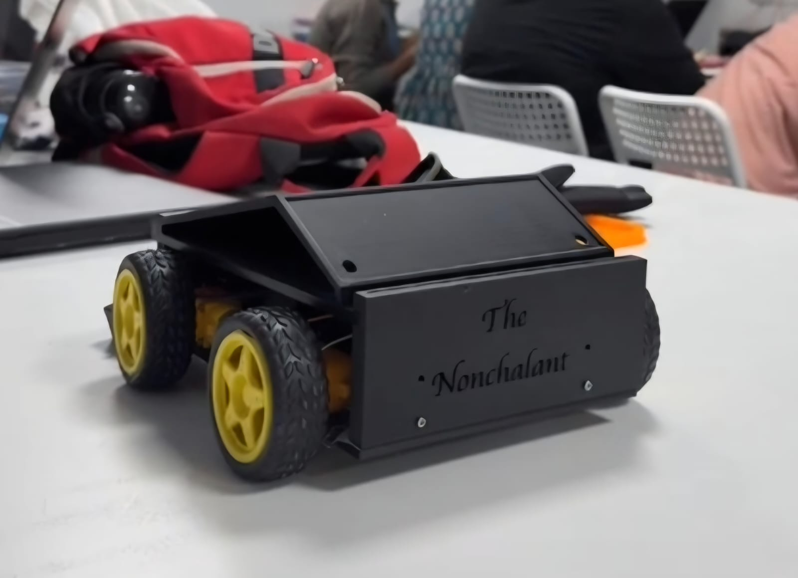

## 1 Starting the Project

I wanted to try making something that moves based on hand gestures

The idea was to use a sensor to read how I tilt my hand and send that movement to the car

I chose an MPU9250 sensor and two ESP32 boards

I used ESP NOW because it lets the two boards communicate wirelessly

For the car I used four BO motors and an L298N motor driver

I also added an ultrasonic sensor to detect things in front of the car

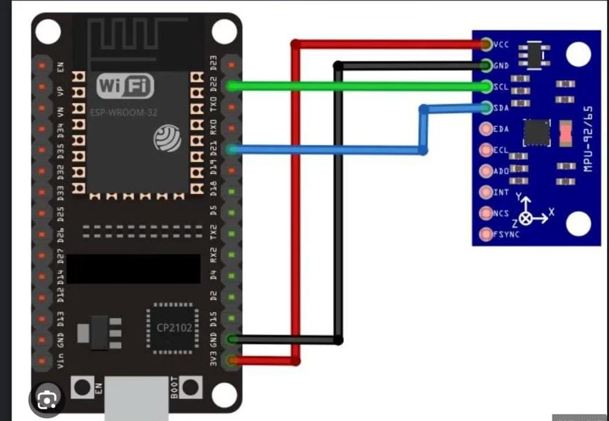

## 2 Wiring

I started by connecting the MPU9250 sensor to the controller ESP32

I used GPIO 15 for SDA and GPIO 14 for SCL

For the car I connected the L298N motor driver to GPIO 26 25 17 and 16

GPIO 32 and 33 are used to control the motor speed

I connected the ultrasonic sensor using GPIO 18 for Trigger and GPIO 19 for Echo

I also used a resistor divider for the Echo pin because the sensor sends a 5V signal and the ESP32 needs 3.3V

I connected the grounds together and made sure the motors were powered through the driver

## 3 Designing the Car

I used Fusion 360 to make the car body

I wanted to design the chassis myself so I could place the motors and electronics where I wanted

I started by making the base and then worked on the motor mounts

After that I made space for the battery ESP32 and motor driver

I also made a place for the ultrasonic sensor at the front

I checked the full model to see how the parts would fit together before printing

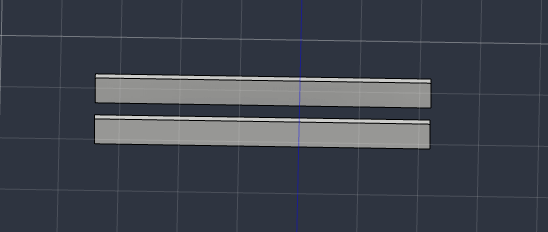

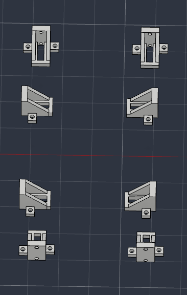

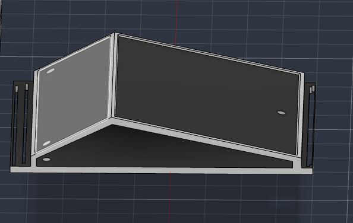

I added some extra support around the chassis and motor mounts

Then I saved the design in Fusion 360 and STEP formats

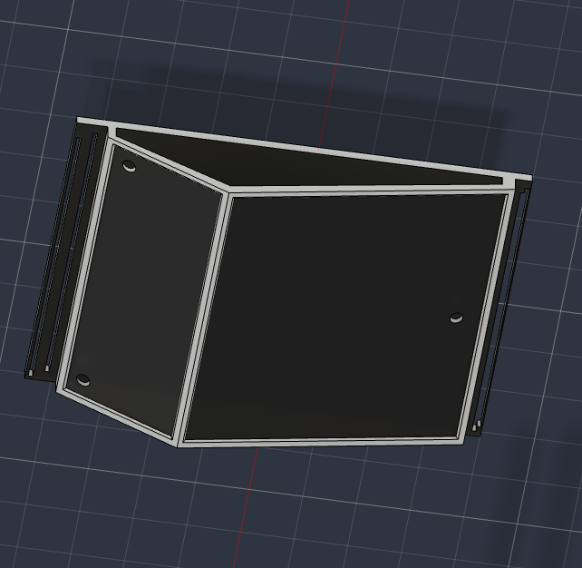

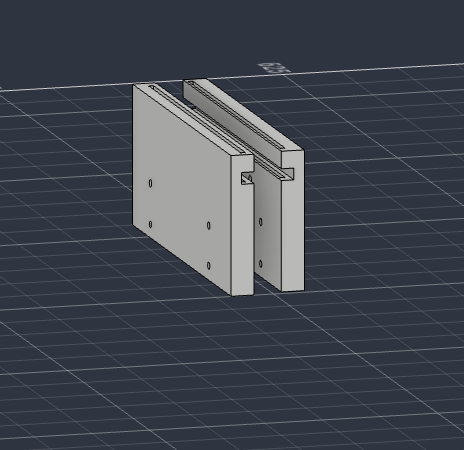

## 4 Building the Car

After finishing the design I printed the chassis parts

I attached the four BO motors and fitted the wheels

Then I placed the ESP32 and L298N motor driver inside the chassis

I mounted the ultrasonic sensor at the front

After that I connected the wires and checked if the wheels could rotate without touching the body

I tried to keep the electronics inside the chassis so everything would fit properly

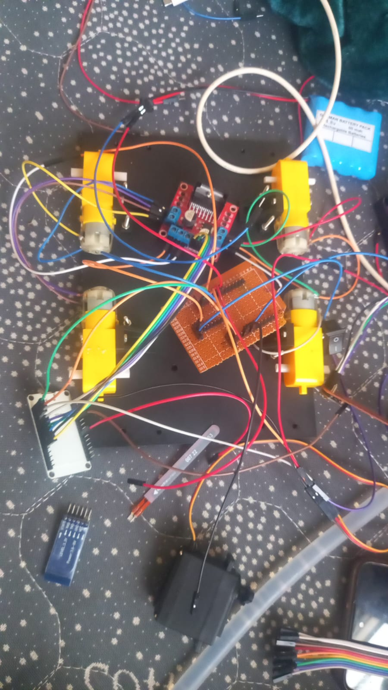

## 5 Hand Controller Code

I wrote the hand controller code in Arduino IDE

The MPU9250 sensor reads the tilt of my hand

The ESP32 uses these readings to decide which command to send to the car

I kept the tilt limit at 15 degrees so small hand movements would not make the car move

When my hand is level the controller sends a stop command

The controller sends commands every 100 milliseconds using ESP NOW

I also added the MAC address of the car ESP32 in the controller code

The MAC address in the project code is only an example and needs to be replaced

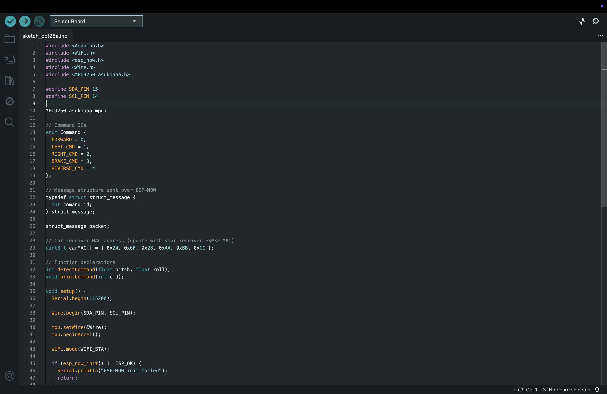

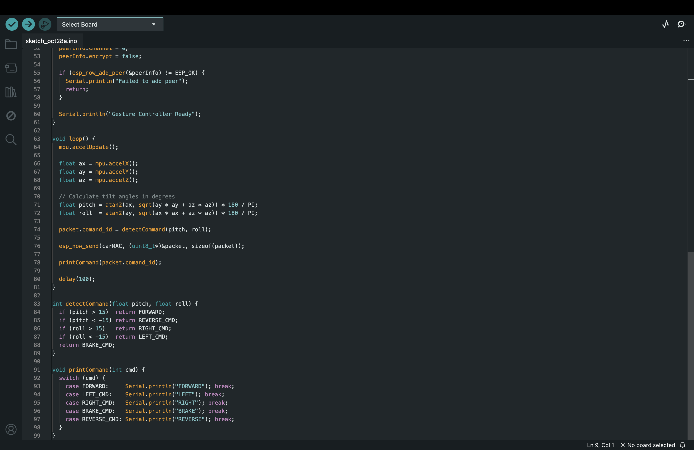

## 6 Car Receiver Code

Next I worked on the code for the ESP32 inside the car

This ESP32 receives commands from the hand controller and controls the motors using the L298N driver

I used GPIO 32 and 33 to control the motor speed

The speed is set to 180 out of 255

For turning the car runs the motors on one side while stopping the motors on the other side

I also added a reverse mode

When I tilt my hand backward the car switches to reverse mode

Tilting backward again changes it back to forward mode

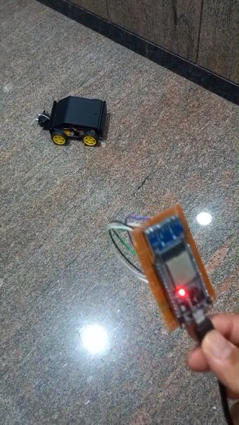

## 7 Obstacle Detection

I added an HC SR04 ultrasonic sensor at the front of the car

I wanted the car to detect objects in front of it while moving

I set the distance limit to 20 cm

When something comes closer than 20 cm the car stops and turns right for a short time

After turning it stops again

The code also checks the distance before moving forward

This helps the car avoid objects in front of it

## 8 Testing the Car

After connecting everything I started testing the car

I checked the motor directions with the wheels raised before putting the car on the floor

Then I tried moving my hand forward left and right to check if the car responded correctly

I also checked the reverse mode by tilting my hand backward

After that I tested the ultrasonic sensor by placing an object in front of the car

I checked how the car stopped and turned when the object was close

## 9 Demo

I recorded a short video to show the car working

In the video I used the hand controller to move the car in different directions

The ESP32 on the controller sends commands wirelessly to the ESP32 on the car

The car then moves based on how I tilt my hand

This video shows the car after putting together the code electronics and 3D printed parts

[Watch the Driving Video](assets/VIDEO-2026-10-23-02-05-10.mp4)

## 10 Final Notes

This project was my attempt to make a car that works using hand gestures instead of a normal remote

I got to work with ESP32 boards ESP NOW sensors motor drivers and Fusion 360

I learned how to send commands wirelessly and use those commands to control the motors

I also got more experience with wiring designing parts and putting together a working car

There are still a few things I would like to improve later

Overall I enjoyed making The Nonchalant and seeing the car move using my hand movements

