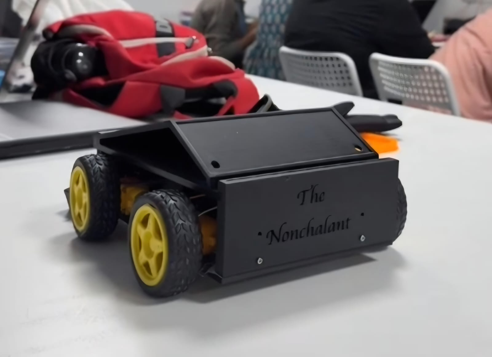
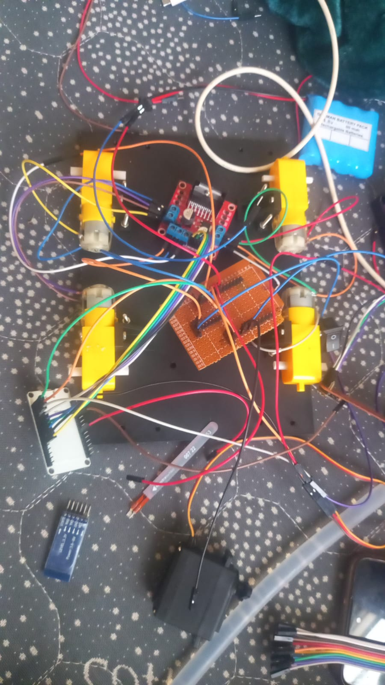
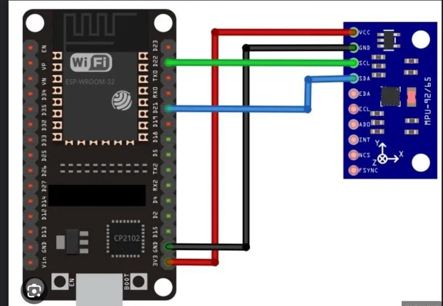
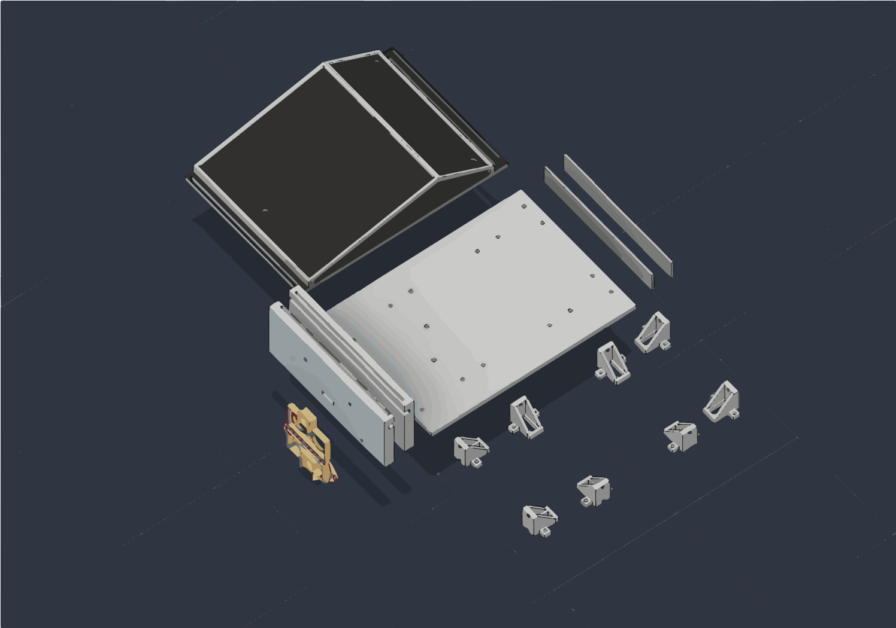

# The Nonchalant

### A Hand Gesture Controlled Car Using ESP32

The Nonchalant is a 4 wheel drive car that I made using ESP32 and a few sensors

I wanted to make something that I could control without using a normal remote

So I tried using hand movements to control the car

I used an MPU9250 sensor to detect the movement of my hand and two ESP32 boards to send and receive commands using ESP NOW

I also added an ultrasonic sensor to detect obstacles





## 1 How It Works

The idea is simple

I tilt my hand and the car moves in that direction

The MPU9250 reads the movement and sends it to the first ESP32

That ESP32 sends a command to the ESP32 on the car using ESP NOW

The second ESP32 receives the command and controls the motors using an L298N motor driver

These are the controls

- Tilt forward to move forward
- Tilt left to turn left
- Tilt right to turn right
- Keep my hand level to stop
- Tilt backward to change reverse mode
- Tilt backward again to change back

I set the tilt limit to 15 degrees

The controller sends commands every 100 milliseconds

For turning I control the motors on the left and right separately

I also placed an HC SR04 sensor at the front of the car

When something is closer than 20 cm the car stops turns right for a short time and stops again

### Working Flow

```text
Hand Movement
      |
   MPU9250
      |
Controller ESP32
      |
    ESP NOW
      |
  Car ESP32
      |
     L298N
      |
   4 Motors
```

## 2 Parts Used

These are the parts I used

| Part | Quantity |
|---|---|
| ESP32 | 2 |
| MPU9250 | 1 |
| L298N Motor Driver | 1 |
| BO Motors | 4 |
| Wheels | 4 |
| HC SR04 | 1 |
| 7.4V Battery | 1 |
| 3D Printed Parts | As needed |

I used 3D printed parts to make the body of the car and to hold everything in place

## 3 Wiring

### Hand Controller

I connected the MPU9250 to the first ESP32

| MPU9250 | ESP32 |
|---|---|
| VCC | 3V3 |
| GND | GND |
| SDA | GPIO 15 |
| SCL | GPIO 14 |

### Motor Driver

I connected the L298N to the ESP32 on the car

| L298N | ESP32 |
|---|---|
| IN1 | GPIO 26 |
| IN2 | GPIO 25 |
| IN3 | GPIO 17 |
| IN4 | GPIO 16 |
| ENA | GPIO 32 |
| ENB | GPIO 33 |

The left two motors are connected to one side of the motor driver

The right two motors are connected to the other side

This lets me change the speed of each side when turning

### Ultrasonic Sensor

| HC SR04 | ESP32 |
|---|---|
| VCC | 5V |
| GND | GND |
| TRIG | GPIO 18 |
| ECHO | GPIO 19 |

The Echo pin goes through a resistor divider before connecting to the ESP32

This brings the 5V signal down to 3.3V

I connected all the grounds together and powered the motors through the motor driver

### Circuit Diagram



## 4 Code Setup

I used Arduino IDE to upload the code to both ESP32 boards

1. Install Arduino IDE
2. Install the ESP32 board package
3. Install the MPU9250_asukiaaa library
4. Find the MAC address of the ESP32 on the car
5. Open GestureController and change the carMAC value
6. Upload GestureController to the hand controller
7. Upload GestureCarReceiver to the car
8. Open the serial monitor at 115200 baud
9. Check if the boards are communicating
10. Test the motors with the wheels off the ground

The MAC address in the controller code is only an example

You need to replace it with the actual receiver MAC address

## 5 Car Design

I used Fusion 360 to design the car

I kept the design simple because I needed space for the motors battery and electronics

The chassis uses 3D printed parts

I also exported the model as a STEP file



### Design Files

- [Fusion 360 File](3D%20Cad/The%20Nonchalant%20%281%29.f3d)
- [STEP File](3D%20Cad/The%20Nonchalant.step)

## 6 Project Files

I added the code photos CAD files and video to the project folder

- `GestureController` has the code for the hand controller
- `GestureCarReceiver` has the code for the car
- `3D Cad` has the car design
- `assets` has the photos diagram and video
- [JOURNAL.md](JOURNAL.md) has the build notes

## 7 Testing

I tested the car by tilting my hand forward backward left and right

The controller sends the commands wirelessly and the car moves based on them

I also tested the ultrasonic sensor by placing an object in front of the car

### Demo Video

[Watch the Driving Video](assets/VIDEO-2026-10-23-02-05-10.mp4)

## 8 Things I Learned

I learned how to connect two ESP32 boards using ESP NOW

I also got to work with the MPU9250 sensor and understand how its readings can be used to control something

I learned more about motor drivers and how to control the left and right wheels separately

I also got to use Fusion 360 for designing the car body

## 9 Conclusion

I made this car because I wanted to try controlling something using hand movements

The main idea was to make a car that works without a normal remote

This project gave me a chance to work with sensors wireless communication motors and 3D design

I still have some ideas to improve it later
